<div align="center">

# EasyBuy

**A full-stack MERN e-commerce platform with editorial UI, Stripe payments, Redis caching, and Gemini AI product descriptions.**

[](https://easybuyz.vercel.app/)
[](https://react.dev/)
[](https://nodejs.org/)
[](https://www.mongodb.com/)
[](https://upstash.com/)
[](https://stripe.com/)

[Live Website](https://easybuyz.vercel.app/) · [Report Bug](https://github.com/vishalpohar/ecommerce-store/issues) · [Request Feature](https://github.com/vishalpohar/ecommerce-store/issues)

</div>

---

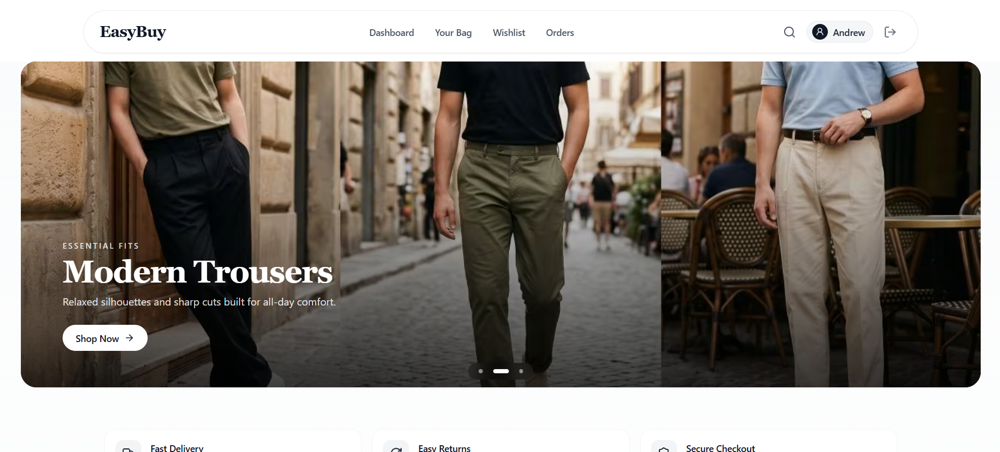

## Overview

**EasyBuy** is a full-stack e-commerce web application built on the MERN stack. It provides a responsive, accessible shopping experience for customers—complete with Stripe checkout, coupon discounts, and order tracking—alongside a dedicated Seller Dashboard featuring real-time Recharts analytics and Gemini AI-assisted product listing.

---

## Key Features

### Customer Storefront
- **Editorial UI & Responsive Design:** Mobile-first interface built with Tailwind CSS, semantic HTML, and ARIA accessibility.
- **Discovery & Filtering:** Category browsing, product search, curated collections, and "People Also Bought" recommendations.
- **Shopping Bag & Wishlist:** Persistent cart and wishlist state management with real-time INR (`₹`) pricing and coupon code support.
- **Flexible Checkout:** Supports both full-cart checkout and single-item **Buy Now** flows powered by **Stripe Checkout**.
- **Order Management:** Dedicated order confirmation, cancellation recovery, and **My Orders** history pages.

### Seller Dashboard
- **Product Management (CRUD):** Create, edit, and delete products with **Cloudinary** image uploads and optimization.
- **AI Product Descriptions:** Integrated **Google Gemini API** to auto-generate polished product descriptions directly inside the product form.
- **Analytics Dashboard:** Interactive **Recharts** sales and revenue visualizations with `7d`, `30d`, and `90d` time-range filtering.

### Security & Performance
- **JWT Authentication & RBAC:** Secure Access + Refresh token flow with role-based access control (`customer` and `seller`).
- **Redis Caching:** **Upstash Redis** caching layer for frequently accessed catalog data to reduce database load and API latency.
- **Frontend Performance:** Responsive `<picture>` / `srcset` hero banners (`AVIF` & `WebP`), LCP preloading, route-level lazy loading, and lightweight pure-CSS loading animations.

---

## Tech Stack

| Layer | Technologies |
| :--- | :--- |
| **Frontend** | React.js, Tailwind CSS, Zustand, React Router DOM, Axios, Recharts, Lucide React |
| **Backend** | Node.js, Express.js, JWT (Access & Refresh Tokens), Nodemailer |
| **Database & Cache** | MongoDB (Mongoose), Upstash Redis |
| **Integrations** | Stripe API, Google Gemini API, Cloudinary |
| **Deployment & Tools** | Vercel (Frontend), Render (Backend), Postman, Git & GitHub |

---

## Screenshots

<details open>
<summary><strong>Storefront & Product Discovery</strong></summary>
<br />

| Collections | Featured Products |
| :---: | :---: |
| 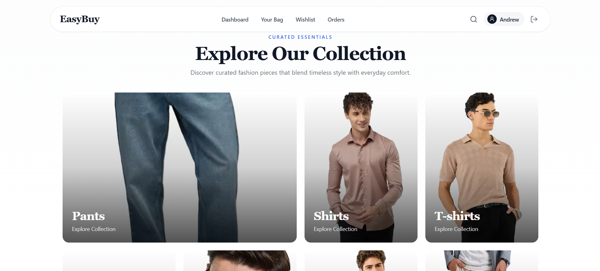 | 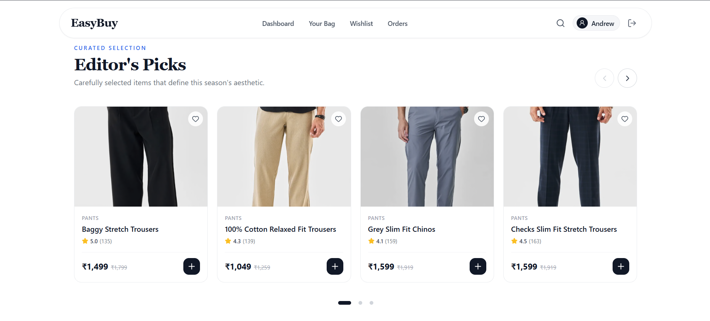 |

| Category Page | Frequently Bought |
| :---: | :---: |
| 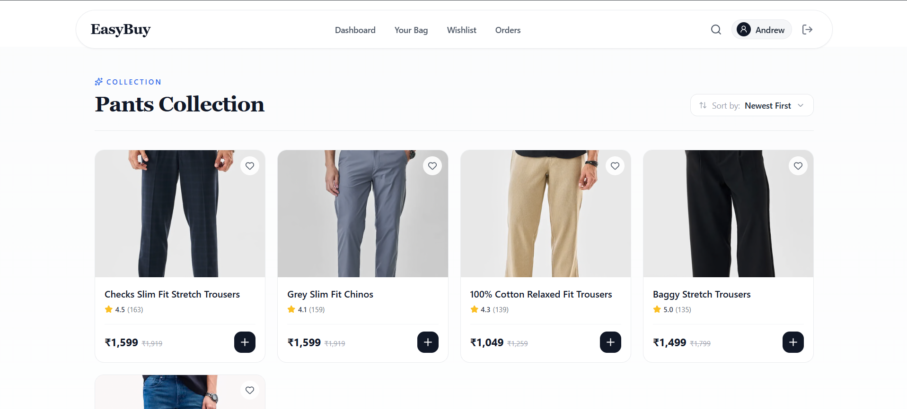 | 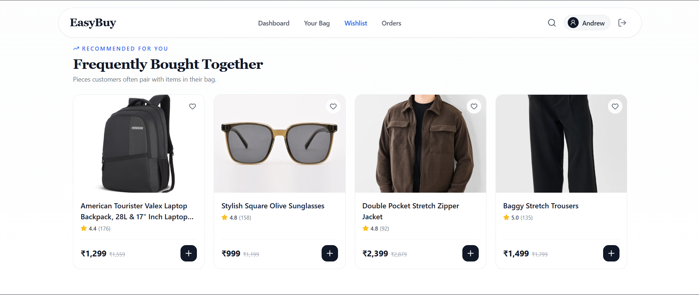 |

</details>

<details>
<summary><strong>Cart, Wishlist & Checkout Flow</strong></summary>
<br />

| Cart Page | Wishlist Page |
| :---: | :---: |
| 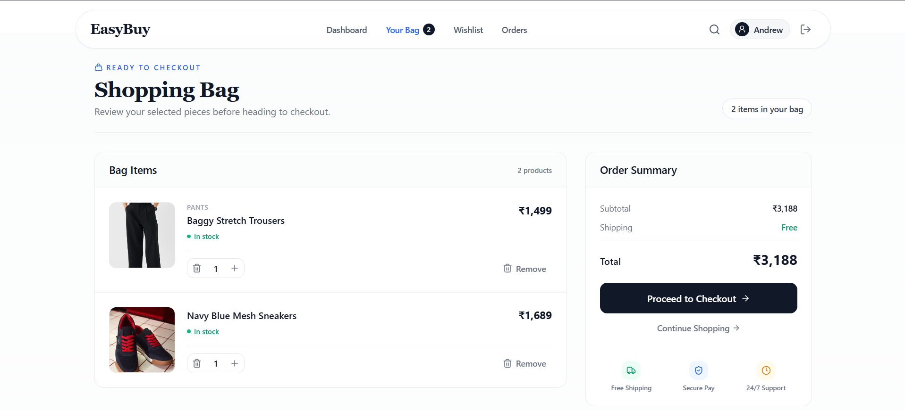 | 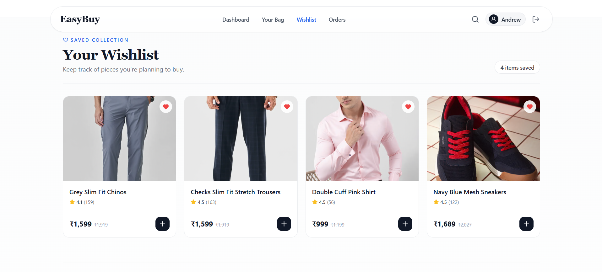 |

| Order Success | Payment Cancelled |
| :---: | :---: |
| 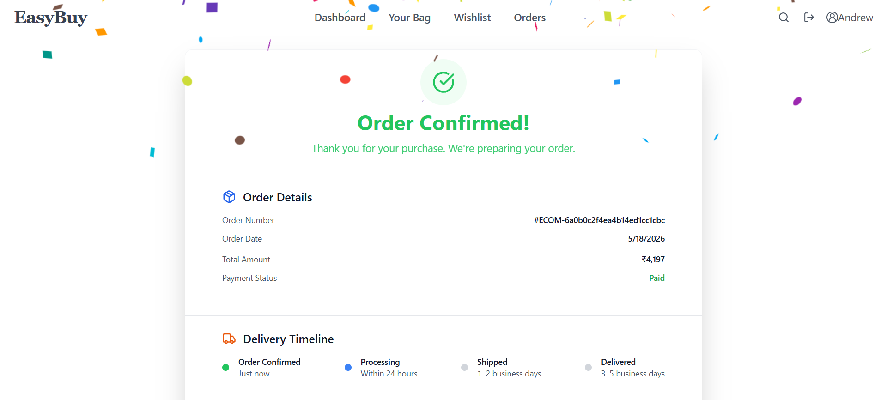 | 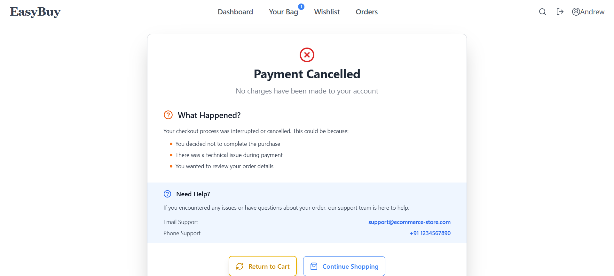 |

| My Orders |
| :---: |
| 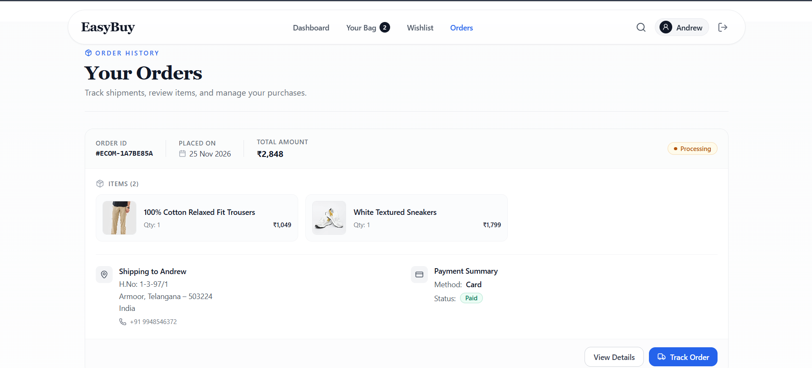 |

</details>

<details>
<summary><strong>Seller Dashboard & Analytics</strong></summary>
<br />

| Analytics Dashboard | Product List |
| :---: | :---: |
| 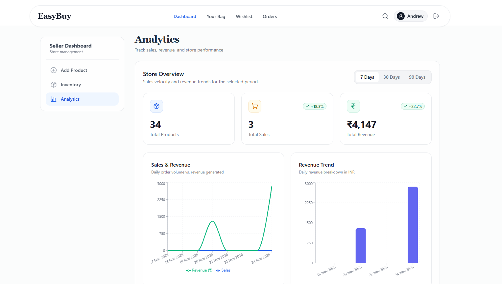 | 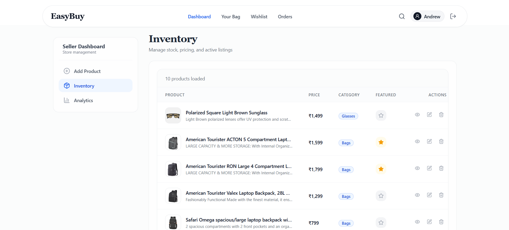 |

| Add / Edit Product Form (with Gemini AI) |
| :---: |
| 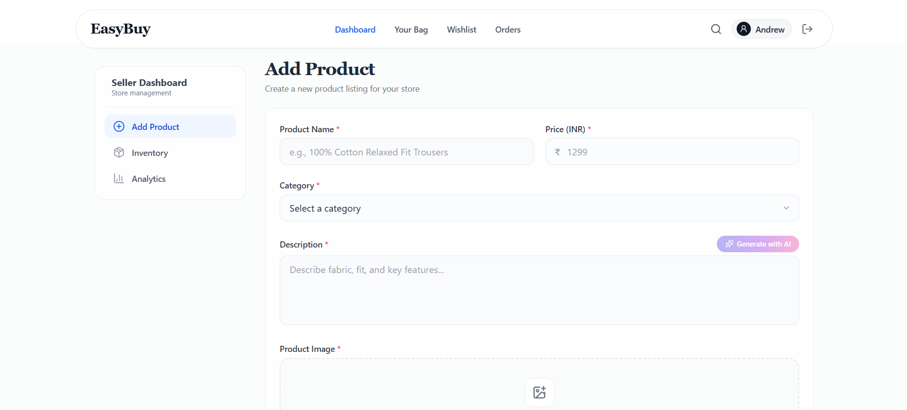 |

</details>

---

## Getting Started

### Prerequisites
- **Node.js** `v18+` and **npm**
- **MongoDB** URI (Atlas or local)
- Accounts/keys for **Upstash Redis**, **Stripe**, **Cloudinary**, and **Google Gemini API**

### 1. Clone the Repository

```bash
git clone https://github.com/vishalpohar/ecommerce-store.git
cd ecommerce-store
```

### 2. Install Dependencies

```bash
# Install backend dependencies
cd server
npm install

# Install frontend dependencies
cd ../client
npm install
```

### 3. Configure Environment Variables

Create a `.env` file inside `server/`:

```env
PORT=5000
NODE_ENV=development
CLIENT_URL=http://localhost:5173

# Database & Cache
MONGO_URI=your_mongodb_connection_string
UPSTASH_REDIS_URL=your_upstash_redis_url
UPSTASH_REDIS_TOKEN=your_upstash_redis_token

# Authentication
JWT_SECRET=your_jwt_secret
ACCESS_TOKEN_SECRET=your_access_token_secret
REFRESH_TOKEN_SECRET=your_refresh_token_secret

# Payments & Media
STRIPE_SECRET_KEY=your_stripe_secret_key
CLOUDINARY_CLOUD_NAME=your_cloudinary_cloud_name
CLOUDINARY_API_KEY=your_cloudinary_api_key
CLOUDINARY_API_SECRET=your_cloudinary_api_secret

# AI & Email
GEMINI_API_KEY=your_gemini_api_key
EMAIL_USER=your_email_address
EMAIL_PASS=your_email_app_password
```

Create a `.env` file inside `client/`:

```env
VITE_API_URL=http://localhost:5000/api
VITE_STRIPE_PK=your_stripe_publishable_key
```

### 4. Run Locally

Open two terminals:

```bash
# Terminal 1 — Start Backend
cd server
npm run dev
```

```bash
# Terminal 2 — Start Frontend
cd client
npm run dev
```

The app will be available at `http://localhost:5173` and the API at `http://localhost:5000`.

---

## Performance & Optimization Highlights

- **Caching:** Upstash Redis caches high-read product endpoints to cut response times and database load.
- **Image Pipeline:** Static hero banners use responsive `640w` / `1280w` `AVIF` and `WebP` formats with `<link rel="preload">`; dynamic product images use Cloudinary `f_auto,q_auto` transformations.
- **Bundle & Rendering:** Component lazy loading, custom CSS-only animations (no heavy spinner libraries), and optimized MongoDB queries.
- **API Verification:** All REST endpoints, auth guards, and error states were tested and verified with Postman.

---

## Author

**Vishal Pohar**

- GitHub: [@vishalpohar](https://github.com/vishalpohar)
- Email: [vishalpohar11@gmail.com](mailto:vishalpohar11@gmail.com)